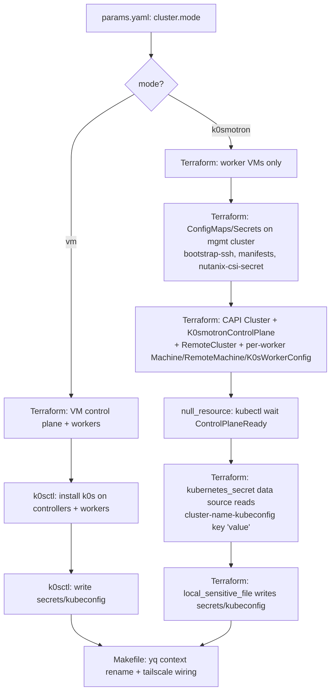

# feat: Add k0smotron cluster mode alongside VM control planes

## Summary

Add a `cluster.mode: vm | k0smotron` flag to `params.yaml` that selects between the existing VM-based control-plane flow and a new k0smotron-hosted control-plane flow. Default is `vm` so existing `params.yaml` files keep working unchanged. In k0smotron mode, the workload cluster's control plane runs as pods on a bring-your-own management Kubernetes cluster while worker nodes remain Nutanix VMs provisioned by this repo and joined via k0smotron's `RemoteMachine` CR (CAPI install). All add-ons that today land on the first controller's `/var/lib/k0s/manifests/` directory (cert-manager, MetalLB, Traefik, Tailscale operator, Nutanix CSI, ACME issuers, optional gVisor/Wasmtime runtimes) are preserved with behavioral parity by translating them into `K0smotronControlPlane.spec.k0sConfig.spec.extensions.helm.charts` (unchanged for helm) and `K0smotronControlPlane.spec.manifests` ConfigMap/Secret references on the management cluster (for raw YAML).

## Problem Frame

Today this repo only produces clusters whose control planes are Nutanix VMs. That model is heavyweight for short-lived test clusters: each cluster costs 1+ control-plane VM (vCPU, RAM, disk) and a few minutes of `terraform apply` + `k0sctl apply` for the control plane alone, plus the operator has to keep track of MAC reservations, DHCP, and per-cluster external DNS. For homelab use cases where the operator already has a long-running cluster, k0smotron offers a hosted-control-plane model that eliminates control-plane VMs entirely while preserving the existing worker provisioning, CSI/networking stack, and operator workflow. The repo should support both — VM mode for primary/management clusters, k0smotron mode for ephemeral or tenant-style clusters — selected per cluster via a flag in `params.yaml`.

## Goals

- **G1.** A single `cluster.mode` flag in `params.yaml` selects VM vs k0smotron behavior; default is `vm` so no existing `params.yaml` breaks.
- **G2.** `make cluster` works end-to-end in both modes and ends in the same state: `secrets/kubeconfig` is an admin kubeconfig for the workload cluster.
- **G3.** Add-on parity across modes: cert-manager, MetalLB (+ pool), Traefik, Tailscale operator, Nutanix CSI (+ storageclasses + Files storageclass), ACME `ClusterIssuer`s, and optional gVisor/Wasmtime runtime classes all reach the workload cluster in both modes.
- **G4.** Worker provisioning is shared: Nutanix VMs from `worker.tf` join either a VM-hosted or k0smotron-hosted control plane.
- **G5.** `make destroy` cleans up everything Terraform created in both modes, including k0smotron CRs and worker VMs.

## Non-Goals

- This plan does not provision or maintain the management cluster. The operator must already have one with cert-manager, Cluster API core, and the k0smotron CAPI providers installed.
- This plan does not switch worker provisioning to CAPI declarative scale-out (no `MachineDeployment` / `PooledRemoteMachine`). Workers are one-per-VM, statically defined, matching today's `var.workers` model.
- This plan does not migrate an existing VM-mode cluster's state to k0smotron in place. Switching `cluster.mode` on an existing cluster_name is destructive — TF will destroy control-plane VMs.
- This plan does not address standalone (non-CAPI) k0smotron install. RemoteMachine workers require CAPI.

## Origin Context

No upstream brainstorm document. Scope established directly through the planning bootstrap conversation. Decisions confirmed during planning:

- Management cluster: bring-your-own; kubeconfig path supplied via `params.yaml`. No auto-bootstrap.
- Workers: still Nutanix VMs from this repo (`worker.tf` unchanged).
- Bootstrap delivery: k0smotron-native (`spec.manifests` ConfigMap/Secret references + `spec.k0sConfig.spec.extensions.helm`).
- API exposure: LoadBalancer Service on mgmt cluster, MetalLB-annotated to a pre-reserved IP; operator CNAMEs `${cluster_name}.${domain}` to that IP.
- Param shape: `cluster.mode: vm | k0smotron` (default `vm`) with nested `cluster.k0smotron:` block for mode-specific config.
- Control-plane TF gating: conditional `count` on existing resources (single state, single root).
- Raw manifests: ConfigMap (and Secret for credentials) on mgmt cluster, referenced via `spec.manifests`. Static manifests use `fileset()` + `file()` with no templating; rendered ones go straight from `templatefile()` into `kubernetes_secret`/`kubernetes_config_map` data without intermediate disk files.
- Workload kubeconfig: Terraform fetches via `kubectl wait` + `kubernetes_secret` data source + `local_sensitive_file`.
- Worker SSH key for `RemoteMachine`: bootstrap keypair generated by Terraform (`tls_private_key`); public half injected into cloud-init alongside user-provided keys; private half stored as a mgmt-cluster Secret with key `value`.

---

## Key Technical Decisions

### KTD1. Use the CAPI flavor of k0smotron, not standalone

`RemoteMachine` lives in the `infrastructure.cluster.x-k8s.io/v1beta1` provider, which only ships with the CAPI install of k0smotron. The standalone `k0smotron.io/v1beta1 Cluster` CR cannot reference `RemoteMachine`. Since we committed to `RemoteMachine` workers (no `k0sctl` in this mode), CAPI is the only path.

**Implication:** per cluster we apply six kinds of CR: CAPI `Cluster`, `K0smotronControlPlane`, `RemoteCluster` (empty-spec placeholder fulfilling the CAPI infra-cluster contract), and per worker: `Machine`, `RemoteMachine`, `K0sWorkerConfig`. More objects than standalone, but Terraform renders them from templates so the operator-facing surface stays small.

### KTD2. Single Terraform root, single state, conditional `count` on VM resources

Control-plane VM resources (`nutanix_virtual_machine.control_plane`, its `random_id`/`random_uuid` siblings, the `data.nutanix_virtual_machine.control_plane` lookup, and `local_sensitive_file.k0sctl`) all gate via `count = var.cluster_mode == "vm" ? var.controllers : 0` (or `: 1` for the k0sctl file). Worker VM resources are unchanged. New k0smotron-mode resources gate via `count = var.cluster_mode == "k0smotron" ? 1 : 0` (or per worker for `RemoteMachine`).

**Rationale:** preserves existing TF state layout for current users (no migration), keeps one `terraform init`/`apply`/`destroy` workflow, lands as a focused diff. Cost: switching `cluster.mode` on a live cluster is destructive — addressed via a Makefile guard (KTD7).

### KTD3. Two `k0sctl.tftpl` variants instead of one branched template

VM mode keeps today's `k0sctl.tftpl` (controllers + workers + full inline k0s config + manifest `files:` entries pointing at on-disk paths). k0smotron mode has no `k0sctl.tftpl` at all — k0smotron handles worker bootstrap via `RemoteMachine` + `K0sWorkerConfig`. The existing template is therefore unchanged; we simply skip rendering it when `cluster_mode == "k0smotron"`.

### KTD4. Raw manifests delivered as `Volume`-shaped entries in `spec.manifests`

k0smotron's `spec.manifests` field is an array of standard Kubernetes `Volume` objects (not `LocalObjectReference`s). Each volume is mounted into the hosted control-plane pod at `/var/lib/k0s/manifests/<volume.name>/`, where the k0s stack-applier picks it up with the same retry-until-CRDs-exist semantics as native k0s. Configuration entries reference one `ConfigMap` per manifest bundle (`metallb-config`, `cert-manager`, `acme`, `nutanix-csi-config`, `runtimes` when enabled) and one `Secret` for the credentials-bearing nutanix-csi-secret. Each ConfigMap's `data` is built by `fileset()` + `file()` for static bundles, or by direct `templatefile()` call for the rendered ones — no intermediate `local_sensitive_file` in this mode.

**Filename ordering within a bundle:** because helm chart `order:` is broken upstream (RISK-2), CRD-dependent manifests must rely on stack-applier retry, not on chart-order. This works today in VM mode and continues to work here.

### KTD5. Service exposure: LoadBalancer + MetalLB annotations + explicit `externalAddress`

The `K0smotronControlPlane.spec.service` block sets:

```yaml
service:
  type: LoadBalancer
  apiPort: 6443
  konnectivityPort: 8132
  annotations:
    metallb.universe.tf/loadBalancerIPs: "<external-ip-from-params>"
```

Plus `spec.externalAddress: "<same-ip>"` set explicitly to ensure that IP gets baked into `api.sans` and the generated kubeconfig's `server:` URL at first reconciliation, eliminating the chicken-and-egg where k0smotron tries to autodetect the LB IP before MetalLB has allocated it.

The operator CNAMEs `${cluster_name}.${domain}` to that IP. Workload-cluster API is reachable at the FQDN exactly as in VM mode.

### KTD6. Bootstrap SSH keypair generated by Terraform, private half stored as mgmt-cluster Secret

Terraform creates a `tls_private_key.bootstrap_ssh` per cluster_name. The OpenSSH-formatted public key is appended into cloud-init `ssh_authorized_keys` alongside the user-provided keys (so the operator can still SSH in for debugging). The PEM-encoded private key is stored as a `kubernetes_secret.bootstrap_ssh` on the mgmt cluster in the configured namespace, with the private key under the secret key **`value`** (required by `RemoteMachine.spec.sshKeyRef`). Each `RemoteMachine` references this secret by name.

**Effect:** the bootstrap key is self-contained per cluster, never on the operator's filesystem, and rotates automatically when the cluster is destroyed and recreated. Operator's personal keys are unaffected and still grant SSH access.

### KTD7. Mode-switch guard in Makefile

The Makefile reads `cluster.mode` from `params.yaml` and compares to the current TF state. If `terraform state list` shows VM control-plane resources but `cluster.mode` is now `k0smotron` (or vice versa), `make cluster` prints a loud warning and refuses to proceed without `CONFIRM_MODE_SWITCH=1` in the environment. Switching mode is supported; surprise destruction is not.

---

## Output Structure

Files created or substantially modified:

```
docs/plans/2026-05-26-001-feat-k0smotron-cluster-mode-plan.md   (this plan)
secrets/REDACTED-params.yaml                                     (params schema docs)
Makefile                                                         (mode-aware orchestration)
src/terraform/
  providers.tf            (+ kubernetes provider, tls provider)
  variables.tf            (+ cluster_mode and cluster_k0smotron_*)
  control-plane.tf        (conditional count)
  worker.tf               (unchanged shape; cloud-init key list grows)
  cluster.tf              (split: VM-mode local_sensitive_files gated; new k0smotron blocks added)
  k0smotron.tf            (NEW — all k0smotron CR application + kubeconfig fetch)
  output.tf               (conditional control-plane outputs; new k0smotron_endpoint output)
  templates/
    k0sctl.tftpl                                  (unchanged — VM mode only)
    user-data.tftpl                               (accepts bootstrap_ssh_pubkey)
    nutanix-csi-secret.yaml.tftpl                 (unchanged — reused for k0smotron Secret)
    nutanix-storageclass.yaml.tftpl               (unchanged)
    nutanix-files-storageclass.yaml.tftpl         (unchanged)
    default-ipaddresspool.yaml.tftpl              (unchanged)
    k0smotron-cluster.yaml.tftpl                  (NEW — CAPI Cluster + RemoteCluster)
    k0smotron-controlplane.yaml.tftpl             (NEW — K0smotronControlPlane CR)
    k0smotron-worker.yaml.tftpl                   (NEW — per-worker Machine + RemoteMachine + K0sWorkerConfig)
README.md                                          (+ k0smotron prerequisites section)
```

This tree is a scope declaration. The implementer may consolidate or split templates if reality shows a cleaner factoring.

---

## High-Level Technical Design

This illustrates the intended approach and is directional guidance for review, not implementation specification.

### Mode-switch flow



### params.yaml shape (additions)

```yaml
cluster:
  mode: vm              # vm | k0smotron — default vm; k0smotron requires .k0smotron block
  controllers: 1        # ignored when mode == k0smotron
  workers: 2
  load_balancer_cidr: 10.26.0.65/28   # workload-cluster LB pool, unchanged
  k0smotron:                                 # only consulted when mode == k0smotron
    management_kubeconfig: /path/to/kc       # path to BYO mgmt cluster kubeconfig (sensitive — see RISK-7)
    namespace: clusters                      # namespace on mgmt cluster for all CRs/CMs/Secrets
    external_ip: 10.26.0.100                 # required; pre-reserved mgmt-cluster MetalLB IP for the workload apiserver
    k0s_version: v1.35.2+k0s.0               # workload cluster k0s version; default mirrors VM-mode default
```

`mode: vm` (or `mode:` omitted) preserves today's behavior exactly. `cluster.k0smotron.*` keys are only read when `mode: k0smotron`.

### K0smotronControlPlane sketch

```yaml
apiVersion: controlplane.cluster.x-k8s.io/v1beta1
kind: K0smotronControlPlane
metadata:
  name: ${cluster_name}
  namespace: ${k0smotron_namespace}
spec:
  version: ${k0s_version}
  replicas: 1
  externalAddress: ${external_ip}            # explicit, eliminates LB autodetect race
  service:
    type: LoadBalancer
    apiPort: 6443
    konnectivityPort: 8132
    annotations:
      metallb.universe.tf/loadBalancerIPs: "${external_ip}"
  k0sConfig:
    apiVersion: k0s.k0sproject.io/v1beta1
    kind: ClusterConfig
    spec:
      network:
        provider: calico
        calico: { overlay: CrossSubnet, wireguard: true }
        podCIDR: 10.244.0.0/16
        serviceCIDR: 10.96.0.0/12
      extensions:
        helm:
          repositories: [ ... copied from current k0sctl.tftpl ... ]
          charts:        [ ... copied from current k0sctl.tftpl ... ]
  manifests:
    - name: nutanix-csi-secret
      secret:
        secretName: ${cluster_name}-nutanix-csi-secret
    - name: nutanix-csi-config
      configMap:
        name: ${cluster_name}-nutanix-csi-config       # storageclass + files-storageclass
    - name: metallb-config
      configMap:
        name: ${cluster_name}-metallb-config           # IPAddressPool + L2Advertisement
    - name: cert-manager
      configMap:
        name: ${cluster_name}-cert-manager
    - name: acme
      configMap:
        name: ${cluster_name}-acme
    # runtimes only when enabled
    - name: runtimes
      configMap:
        name: ${cluster_name}-runtimes
```

### Per-worker CRs sketch

```yaml
apiVersion: cluster.x-k8s.io/v1beta1
kind: Machine
metadata:
  name: ${cluster_name}-worker-${index}
spec:
  clusterName: ${cluster_name}
  bootstrap:
    configRef:
      apiVersion: bootstrap.cluster.x-k8s.io/v1beta1
      kind: K0sWorkerConfig
      name: ${cluster_name}-worker-${index}
  infrastructureRef:
    apiVersion: infrastructure.cluster.x-k8s.io/v1beta1
    kind: RemoteMachine
    name: ${cluster_name}-worker-${index}
---
apiVersion: infrastructure.cluster.x-k8s.io/v1beta1
kind: RemoteMachine
metadata:
  name: ${cluster_name}-worker-${index}
spec:
  address: ${worker_ip}              # from data.nutanix_virtual_machine.worker[index]
  port: 22
  user: ${ssh_user}                  # users[1].name from params
  useSudo: true
  sshKeyRef:
    name: ${cluster_name}-bootstrap-ssh
---
apiVersion: bootstrap.cluster.x-k8s.io/v1beta1
kind: K0sWorkerConfig
metadata:
  name: ${cluster_name}-worker-${index}
spec:
  version: ${k0s_version}
```

---

## Scope Boundaries

### In scope
- New `cluster.mode` flag and `cluster.k0smotron.*` block in `params.yaml`, with VM mode as the default and the existing schema otherwise unchanged
- Conditional gating of control-plane VM resources in Terraform
- New Terraform resources to render bootstrap manifests as ConfigMaps and Secrets on the mgmt cluster
- New Terraform resources to apply CAPI `Cluster`, `K0smotronControlPlane`, `RemoteCluster`, and per-worker `Machine`/`RemoteMachine`/`K0sWorkerConfig`
- Bootstrap SSH keypair generation and injection into cloud-init
- Kubeconfig fetch via `kubectl wait` + `kubernetes_secret` data source + `local_sensitive_file`
- Makefile updates: mode-aware `cluster`, `nodes`, `destroy`, `test` targets; mode-switch guard
- README documentation of mgmt-cluster prerequisites for k0smotron mode

### Deferred to Follow-Up Work
- Standalone (non-CAPI) k0smotron install path — only a follow-up if a use case appears that needs hosted CPs without RemoteMachine workers
- `PooledRemoteMachine` / `MachineDeployment` based worker auto-scaling — out of scope; current static `var.workers` count is sufficient
- Migration tooling from VM mode to k0smotron mode for an existing cluster_name — operator must `make destroy` and recreate
- A second mgmt cluster supported per-`params.yaml` (multi-tenant) — current scope is one mgmt cluster per `params.yaml`
- Automated install of cert-manager / CAPI / k0smotron providers onto the mgmt cluster — operator-managed prerequisite

### Outside this product's identity
- Provisioning the mgmt cluster itself from this repo (would be a separate effort, see Non-Goal above; recommended pattern is to use a VM-mode cluster from this same repo as the mgmt cluster)
- Switching the workload cluster's CNI, CSI, or storage stack — those choices are inherited from current VM-mode parity
- Cluster API providers for Nutanix infra (CAPX) — orthogonal architecture, would replace the Terraform-driven worker model entirely

---

## Assumptions

- Operator already has a Kubernetes cluster reachable via the configured `management_kubeconfig` path, with **cert-manager**, **Cluster API core** (v1.11.x), and **k0smotron CAPI providers** (v1.10.6) pre-installed.
- Mgmt cluster has a working **MetalLB** install with at least one IPAddressPool reachable from the workload-cluster's worker subnet, so the workload apiserver Service gets an externally routable IP.
- DNS for `${cluster_name}.${domain}` is operator-managed; in k0smotron mode it must point to the `external_ip` (CNAME or A record). VM mode's behavior is unchanged.
- Mgmt cluster's pod network can reach the worker VMs over SSH (port 22). Workers' kubelet can reach the workload apiserver at the LB IP on 6443 and konnectivity at 8132.
- Workload cluster uses k0s `v1.35.x+k0s.0`. k0smotron v1.10.6 accepts arbitrary k0s version strings via `spec.version`; this is not formally certified by a published compatibility matrix and should be smoke-tested.

---

## Implementation Units

### U1. Add `cluster.mode` and `cluster.k0smotron.*` to params schema

**Goal:** Document the new schema in `secrets/REDACTED-params.yaml` and surface every new field via `yq` in the Makefile's TFVARS block. Default `cluster.mode` to `vm` so existing `params.yaml` files keep working.

**Requirements:** G1.
**Dependencies:** none.

**Files:**
- `secrets/REDACTED-params.yaml`
- `Makefile`

**Approach:**
- Add to `secrets/REDACTED-params.yaml` under the existing `cluster:` block: `mode: vm`, then a commented `k0smotron:` sub-block listing `management_kubeconfig`, `namespace`, `external_ip`, optional `metallb_pool`, `k0s_version`. Keep prose comments inline (consistent with current file style).
- In the `TFVARS` define block in `Makefile`, add new lines that yq-extract these fields with `// "vm"` and `// ""` defaults so the old `params.yaml` files don't break:
  - `cluster_mode = "$(shell yq '.cluster.mode // \"vm\"' $(params_yaml))"`
  - `cluster_k0smotron_kubeconfig = "$(shell yq '.cluster.k0smotron.management_kubeconfig // \"\"' $(params_yaml))"`
  - `cluster_k0smotron_namespace = "$(shell yq '.cluster.k0smotron.namespace // \"clusters\"' $(params_yaml))"`
  - `cluster_k0smotron_external_ip = "$(shell yq '.cluster.k0smotron.external_ip // \"\"' $(params_yaml))"`
  - `cluster_k0smotron_k0s_version = "$(shell yq '.cluster.k0smotron.k0s_version // \"v1.35.2+k0s.0\"' $(params_yaml))"`

**Patterns to follow:**
- The recent params-restructure commits (b07a870, 47-51) for the `nutanix.files.*` nested-block precedent — same shape of nested params with backwards-compat defaults.
- Existing `enable_gvisor` / `enable_wasm` extractions in the TFVARS block for the `// false` default pattern.

**Test scenarios:**
- Existing `params.yaml` with no `cluster.mode` key produces TFVARS with `cluster_mode = "vm"` and empty k0smotron strings (verify with `make tfvars` against a fixture that omits the new keys).
- `params.yaml` with `cluster.mode: k0smotron` and a populated `cluster.k0smotron:` block produces TFVARS with all six new variables populated correctly.
- `params.yaml` with `cluster.mode: vm` and a populated `cluster.k0smotron:` block (operator left it filled in) still produces `cluster_mode = "vm"` — the k0smotron fields are extracted but ignored by TF gating in U2.

**Verification:** `make tfvars` succeeds on a fixture `params.yaml` for each of the three above cases and the resulting `terrform.tfvars` file matches expected output by inspection.

---

### U2. Wire `cluster_mode` through Terraform variables and gate VM-only resources

**Goal:** Add the new variables to `src/terraform/variables.tf`, gate `control-plane.tf` resources (and the related data source + k0sctl `local_sensitive_file`) behind `var.cluster_mode == "vm"`, and ensure VM-mode `terraform plan` against an unchanged `params.yaml` produces zero diff vs today.

**Requirements:** G1, G2.
**Dependencies:** U1.

**Files:**
- `src/terraform/variables.tf`
- `src/terraform/control-plane.tf`
- `src/terraform/cluster.tf`
- `src/terraform/output.tf`

**Approach:**
- Add to `variables.tf`:
  - `cluster_mode` (string, default `"vm"`, validation regex `^(vm|k0smotron)$`)
  - `cluster_k0smotron_kubeconfig` (string, default `""`)
  - `cluster_k0smotron_namespace` (string, default `"clusters"`)
  - `cluster_k0smotron_external_ip` (string, default `""`)
  - `cluster_k0smotron_k0s_version` (string, default `"v1.35.2+k0s.0"`)
  - Validation: when `cluster_mode == "k0smotron"`, require `cluster_k0smotron_kubeconfig != ""` and `cluster_k0smotron_external_ip != ""` (use a `precondition` on a sentinel `null_resource` or a `validation` block per variable).
- In `control-plane.tf`, change `count = var.controllers` on `random_id.control_plane`, `random_uuid.control_plane`, `nutanix_virtual_machine.control_plane`, and `data.nutanix_virtual_machine.control_plane` to `count = var.cluster_mode == "vm" ? var.controllers : 0`.
- In `cluster.tf`, change `local_sensitive_file.k0sctl` to `count = var.cluster_mode == "vm" ? 1 : 0` (it becomes a counted resource). Update any references downstream.
- In `output.tf`, make `control_plane_ips` return `[]` cleanly when there are no controllers (current `for` comprehension over an empty list is already safe — verify).
- New output `k0smotron_endpoint` is added in U5 — leave a placeholder TODO comment here for forward reference, or just add it now returning `""` in VM mode.

**Patterns to follow:**
- The existing `random_id` / `random_uuid` per-controller pattern (use the same gating expression on all four resources).
- The `output "control_plane_ips"` comprehension already handles empty input.

**Test scenarios:**
- `cluster_mode = "vm"` + unchanged params: `terraform plan` produces zero diff against current state (verify on a state from a live VM-mode cluster, or against a freshly initialized state with the current code as baseline).
- `cluster_mode = "k0smotron"` + populated k0smotron vars: `terraform plan` shows 0 control-plane VM resources to create, worker resources still present, `local_sensitive_file.k0sctl` not created.
- `cluster_mode = "k0smotron"` with missing `cluster_k0smotron_kubeconfig`: `terraform validate` or `plan` fails with a clear precondition error pointing at the missing variable.
- `cluster_mode = "banana"`: validation regex rejects, `terraform plan` fails with the regex message.

**Verification:** Run `terraform plan -var-file=...` on each of the four fixtures above; review the human-readable diff output; confirm exit code is 0 for valid cases and nonzero with the expected message for the invalid case.

---

### U3. Add `kubernetes` and `tls` providers; generate bootstrap SSH keypair

**Goal:** Add the providers needed by U4-U6, generate a per-cluster bootstrap SSH keypair, inject the public key into cloud-init, and stage the private key as a mgmt-cluster Secret in k0smotron mode.

**Requirements:** G3, G4 (worker bootstrap parity), KTD6.
**Dependencies:** U2.

**Files:**
- `src/terraform/providers.tf` (add `kubernetes`, `tls` providers)
- `src/terraform/k0smotron.tf` (NEW — holds `tls_private_key.bootstrap_ssh`, `kubernetes_secret.bootstrap_ssh`)
- `src/terraform/main.tf` (extend the `user_data` local to include the bootstrap public key)
- `src/terraform/templates/user-data.tftpl` (accept extra authorized keys list)

**Approach:**
- In `providers.tf`, add `required_providers` entries for `kubernetes = { source = "hashicorp/kubernetes", version = "~> 2.30" }` and `tls = { source = "hashicorp/tls", version = "~> 4.0" }`. Configure the `kubernetes` provider with `config_path = var.cluster_k0smotron_kubeconfig` (conditional alias if needed for VM mode to skip it; or rely on the provider tolerating an empty config and never being called).
- Create `src/terraform/k0smotron.tf` with all new resources for this feature (keeps the VM-mode files clean):
  - `resource "tls_private_key" "bootstrap_ssh"` — `count = var.cluster_mode == "k0smotron" ? 1 : 0`, algorithm `RSA`, `rsa_bits = 4096` (matches the strength of the existing user-data SSH host keys at the same line).
  - `resource "kubernetes_secret" "bootstrap_ssh"` — `count = var.cluster_mode == "k0smotron" ? 1 : 0`, name `${var.cluster_name}-bootstrap-ssh` in `var.cluster_k0smotron_namespace`, with `data = { value = tls_private_key.bootstrap_ssh[0].private_key_pem }`. Type `Opaque`.
- In `main.tf`'s `user_data` local (lines 26-34, not `cluster.tf`), change the `ssh_authorized_keys` value to be the concatenation of `var.ssh_authorized_keys` and (in k0smotron mode) `[tls_private_key.bootstrap_ssh[0].public_key_openssh]`. The local is consumed by both `control-plane.tf` and `worker.tf`; in k0smotron mode the control-plane consumer is gated to count 0, so the bootstrap key only lands in worker VMs. Use `concat()` with a conditional:
  - `ssh_authorized_keys = yamlencode(concat(var.ssh_authorized_keys, var.cluster_mode == "k0smotron" ? [tls_private_key.bootstrap_ssh[0].public_key_openssh] : []))`
- `templates/user-data.tftpl` already accepts `ssh_authorized_keys` as an opaque YAML-encoded list, no template change needed.

**Patterns to follow:**
- Provider declarations in current `providers.tf` (nutanix, tailscale, carvel).
- The existing `users` JSON-decode + `yamlencode` pattern for the `user_data` local.

**Test scenarios:**
- k0smotron mode: `terraform plan` shows `tls_private_key.bootstrap_ssh[0]` and `kubernetes_secret.bootstrap_ssh[0]` to be created. The rendered `user-data.yaml` contains both the user's keys AND the generated bootstrap pubkey.
- VM mode: neither `tls_private_key` nor `kubernetes_secret` is in the plan. Rendered `user-data.yaml` contains only the user's keys (no change from today).
- Secret data is exactly the PEM private key (not double-base64-encoded, not wrapped in any envelope). `kubectl get secret -o jsonpath='{.data.value}' | base64 -d` round-trips to a valid PEM.

**Verification:** `terraform plan` output inspection; `terraform apply` against a real mgmt cluster (or kind cluster for testing) and confirm the Secret materializes correctly via `kubectl get secret -o yaml`.

---

### U4. Render bootstrap manifests as ConfigMaps and Secrets on the mgmt cluster

**Goal:** For each manifest bundle that today gets `scp`'d to the first controller's `/var/lib/k0s/manifests/`, create a corresponding ConfigMap (or Secret for credential-bearing content) on the mgmt cluster in k0smotron mode. Source YAML files in `manifests/` and `src/terraform/templates/` remain unchanged.

**Requirements:** G3, KTD4.
**Dependencies:** U3.

**Files:**
- `src/terraform/k0smotron.tf` (add `kubernetes_config_map.*` and `kubernetes_secret.nutanix_csi`)
- `src/terraform/cluster.tf` (gate existing `local_sensitive_file.*` blocks behind VM mode)

**Approach:**
- In `cluster.tf`, add `count = var.cluster_mode == "vm" ? 1 : 0` to the existing `local_sensitive_file` resources that today render staging YAML to disk: `nutanix_csi_secret`, `nutanix_storageclass`, `nutanix_files_storageclass`, `ip_address_pool`. In VM mode these still write to `work/manifests/` for k0sctl to ship. In k0smotron mode they are not rendered to disk.
- In `k0smotron.tf`, add the following resources, all gated `count = var.cluster_mode == "k0smotron" ? 1 : 0`, in namespace `var.cluster_k0smotron_namespace`:
  - **`kubernetes_secret.nutanix_csi`** — name `${cluster_name}-nutanix-csi-secret`, `data = { "01-nutanix-csi-secret.yaml" = templatefile(...) }` using the existing `templates/nutanix-csi-secret.yaml.tftpl` with the same arguments as today's `local_sensitive_file.nutanix_csi_secret`.
  - **`kubernetes_config_map.nutanix_csi_config`** — name `${cluster_name}-nutanix-csi-config`, `data` is a map with two keys built from the rendered storageclass templates: `"02-nutanix-storageclass.yaml"` and `"03-nutanix-files-storageclass.yaml"`.
  - **`kubernetes_config_map.metallb_config`** — name `${cluster_name}-metallb-config`, `data` built by `merge()` of: a `for` over `fileset(local.directories.manifests, "metallb-config/*.yaml")` doing `f => file(...)`, plus a single key `"00-default-ipaddresspool.yaml" = templatefile("default-ipaddresspool.yaml.tftpl", ...)`.
  - **`kubernetes_config_map.cert_manager`** — `for` over `fileset(..., "cert-manager/*.yaml")` calling `file()` on each. **The current cert-manager bundle is ≈970KB (measured), at ~95% of the 1MiB etcd ConfigMap limit.** A naive single-ConfigMap render will overflow on the next cert-manager release (and may already exceed the effective ceiling after metadata/managed-fields overhead). See RISK-5 — splitting the bundle is required before first apply, not deferred. Plan: split `00-cert-manager.yaml` along document boundaries into two ConfigMaps (CRDs separately from controllers is the conventional split) and reference both in `spec.manifests` under the same `cert-manager` directory name (or separate names — k0s stack-applier handles both).
  - **`kubernetes_config_map.acme`** — `for` over `fileset(..., "acme/*")` calling `file()` on each.
  - **`kubernetes_config_map.runtimes`** — counted `var.cluster_mode == "k0smotron" && (var.enable_gvisor || var.enable_wasm) ? 1 : 0`; data built conditionally by `merge()` of optional gvisor/wasmtime file reads.

**Patterns to follow:**
- Existing `templatefile()` invocations on the same `.tftpl` files.
- The `for f in fileset(...)` pattern is idiomatic Terraform for bundling directory contents into a map.

**Test scenarios:**
- k0smotron mode with default params: `terraform plan` shows all 5 ConfigMaps and 1 Secret to create. None of the `local_sensitive_file.*` staging files appear in the plan.
- k0smotron mode with `enable_gvisor: true`: the `runtimes` ConfigMap is in the plan and its data contains `gvisor.yaml` only.
- k0smotron mode with both runtimes enabled: `runtimes` ConfigMap data contains both `gvisor.yaml` and `wasmtime-spin.yaml` keys.
- VM mode: zero ConfigMaps/Secrets in plan; `local_sensitive_file.*` staging files render to disk as today.
- ConfigMap data for `cert-manager` round-trips byte-identical with the source YAML files (`diff <(kubectl get cm -o jsonpath='{.data.X}') manifests/cert-manager/X.yaml`).

**Verification:** `terraform apply` against a kind mgmt cluster (or real mgmt cluster), then `kubectl get cm,secret -n clusters` to confirm presence, and diff at least one ConfigMap's contents against source.

---

### U5. Apply k0smotron CAPI resources (Cluster, K0smotronControlPlane, RemoteCluster, per-worker Machine/RemoteMachine/K0sWorkerConfig)

**Goal:** Render and apply the CAPI CR tree that constitutes the k0smotron-hosted workload cluster, including the workload-cluster API exposure on a LoadBalancer Service with an explicit MetalLB IP.

**Requirements:** G2, G3, G4, KTD1, KTD4, KTD5.
**Dependencies:** U3, U4.

**Files:**
- `src/terraform/k0smotron.tf` (resources to apply CR manifests)
- `src/terraform/templates/k0smotron-cluster.yaml.tftpl` (NEW)
- `src/terraform/templates/k0smotron-controlplane.yaml.tftpl` (NEW)
- `src/terraform/templates/k0smotron-worker.yaml.tftpl` (NEW)
- `src/terraform/output.tf` (`k0smotron_endpoint`, `workload_kubeconfig_secret`)

**Approach:**
- New template `k0smotron-cluster.yaml.tftpl` renders the CAPI `cluster.x-k8s.io/v1beta1 Cluster` referencing the `K0smotronControlPlane` and a sibling `RemoteCluster` (empty-spec placeholder per k0smotron CAPI docs).
- New template `k0smotron-controlplane.yaml.tftpl` renders the `controlplane.cluster.x-k8s.io/v1beta1 K0smotronControlPlane` with:
  - `spec.version` from `var.cluster_k0smotron_k0s_version`
  - `spec.externalAddress` from `var.cluster_k0smotron_external_ip`
  - `spec.service.type: LoadBalancer`, `apiPort: 6443`, `konnectivityPort: 8132`, annotation `metallb.universe.tf/loadBalancerIPs: "${external_ip}"`
  - `spec.k0sConfig.spec.network.*` copied verbatim from today's `k0sctl.tftpl` (calico, podCIDR, serviceCIDR)
  - `spec.k0sConfig.spec.extensions.helm.repositories` and `.charts` copied verbatim from today's `k0sctl.tftpl` (nutanix-csi-storage, metallb, tailscale-operator, traefik). `order:` fields preserved for documentation even though upstream-broken (RISK-2).
  - `spec.manifests` listing the 4 base ConfigMaps + 1 conditional ConfigMap (runtimes, only when enabled) + 1 Secret from U4 as `Volume`-shaped entries with `name:` and `{configMap,secret}: { name }`.
- New template `k0smotron-worker.yaml.tftpl` renders one document set per worker (3 YAML documents separated by `---`): `cluster.x-k8s.io/v1beta1 Machine`, `infrastructure.cluster.x-k8s.io/v1beta1 RemoteMachine`, `bootstrap.cluster.x-k8s.io/v1beta1 K0sWorkerConfig`. The `RemoteMachine.spec.address` comes from `data.nutanix_virtual_machine.worker[count.index].nic_list[0].ip_endpoint_list[0].ip`. `RemoteMachine.spec.user` is `local.users[1].name`. `RemoteMachine.spec.sshKeyRef.name` is `${cluster_name}-bootstrap-ssh`. `RemoteMachine.spec.useSudo: true`.
- Apply choice: use the `kubernetes_manifest` resource (one per CR) OR a single `null_resource` running `kubectl apply -f -` with `local-exec`. **Prefer `kubernetes_manifest`** for the Cluster/K0smotronControlPlane/RemoteCluster (so TF tracks them in state and can plan/destroy cleanly). For the per-worker Machine+RemoteMachine+K0sWorkerConfig triplet, use a `for_each` over `data.nutanix_virtual_machine.worker` with `kubernetes_manifest` blocks per document. `kubernetes_manifest` requires the mgmt API reachable at plan time — document this in the README as an operator expectation.
- Add `output "k0smotron_endpoint"` — `var.cluster_k0smotron_external_ip` in k0smotron mode, `""` in VM mode.
- Add `output "workload_kubeconfig_secret"` — the `<cluster>-kubeconfig` secret name+namespace, useful for debugging.

**Patterns to follow:**
- The existing `templatefile()` indirection for k0sctl.
- Verbatim copy of helm extensions from the current `k0sctl.tftpl` (lines 80-145 approx) — same charts, repos, values, namespaces, `order` fields.

**Test scenarios:**
- `terraform plan` in k0smotron mode shows: 1 Cluster, 1 K0smotronControlPlane, 1 RemoteCluster, and `3 × var.workers` documents (Machine + RemoteMachine + K0sWorkerConfig per worker) to create.
- Rendered `K0smotronControlPlane.spec.k0sConfig.spec.extensions.helm.charts` is byte-identical to the helm section of today's `k0sctl.tftpl` after templatefile substitution (compare with `diff` against a known-good rendering).
- Rendered `spec.service` has `type: LoadBalancer`, `apiPort: 6443`, `konnectivityPort: 8132`, and the MetalLB annotation pointing at `external_ip`.
- Rendered `spec.externalAddress` equals `external_ip`.
- Rendered `spec.manifests` array contains an entry per U4 ConfigMap/Secret, each with the right kind reference (`configMap` vs `secret`) and matching name.
- Per-worker rendering: with `workers: 2`, exactly 2 sets of (Machine + RemoteMachine + K0sWorkerConfig) appear; each `RemoteMachine.spec.address` matches the corresponding worker VM IP from the data source.
- Apply against a real mgmt cluster: all CRs land, `kubectl get k0smotroncontrolplane,cluster,remotemachine -n <namespace>` lists them, and after ~2 min `status.conditions[type=ControlPlaneReady]` is `True`.

**Verification:** `terraform plan` document-count check; full `terraform apply` against a mgmt cluster + `kubectl wait --for=condition=ControlPlaneReady k0smotroncontrolplane/<name> --timeout=10m`; manual `kubectl --kubeconfig=<workload-kc> get nodes` after kubeconfig is fetched in U6 to confirm workers join.

---

### U6. Wait for control plane readiness and fetch workload kubeconfig

**Goal:** After applying the CRs in U5, wait for the workload control plane to be ready, then read the auto-generated kubeconfig Secret and write `secrets/kubeconfig`. Result: `secrets/kubeconfig` ends in the same place as VM mode does.

**Requirements:** G2, KTD5 (correct `server:` URL), Assumption that `kubectl` is on the operator's PATH.
**Dependencies:** U5.

**Files:**
- `src/terraform/k0smotron.tf` (null_resource for wait, data source, local_sensitive_file)

**Approach:**
- `resource "null_resource" "wait_control_plane"` — `count = var.cluster_mode == "k0smotron" ? 1 : 0`, `depends_on = [kubernetes_manifest.k0smotron_controlplane[0]]`. `provisioner "local-exec"` runs `kubectl --kubeconfig=${var.cluster_k0smotron_kubeconfig} -n ${var.cluster_k0smotron_namespace} wait --for=condition=ControlPlaneReady --timeout=15m k0smotroncontrolplane/${var.cluster_name}`. The 15-minute default accommodates cold-start image pulls on a fresh mgmt cluster; tune via a variable if needed. `triggers = { cluster_name = var.cluster_name }` so it re-runs on rename but not every apply.
- `data "kubernetes_secret" "workload_kubeconfig"` — `count = var.cluster_mode == "k0smotron" ? 1 : 0`, metadata name `${var.cluster_name}-kubeconfig`, namespace `var.cluster_k0smotron_namespace`. `depends_on = [null_resource.wait_control_plane[0]]`.
- `resource "local_sensitive_file" "workload_kubeconfig"` — `count = var.cluster_mode == "k0smotron" ? 1 : 0`. `content = data.kubernetes_secret.workload_kubeconfig[0].data["value"]`. `filename = "${local.directories.secrets}/kubeconfig"`. `file_permission = "0600"`.

**Patterns to follow:**
- Existing `local_sensitive_file` resources in `cluster.tf` for staging artifacts.
- The Makefile already writes `secrets/kubeconfig` in VM mode via k0sctl — Terraform now produces the same artifact in k0smotron mode.

**Test scenarios:**
- After `terraform apply` in k0smotron mode completes, `secrets/kubeconfig` exists and `kubectl --kubeconfig=secrets/kubeconfig get nodes` returns the worker nodes.
- The `server:` URL in the rendered kubeconfig equals `https://<external_ip>:6443` (verifying `spec.externalAddress` did its job).
- VM mode: none of the three new resources appears in the plan; `secrets/kubeconfig` is produced by k0sctl as today.
- Wait timeout: a mgmt cluster that takes longer than 10 minutes to bring the CP up causes `terraform apply` to fail with a clear `kubectl wait` timeout error rather than hanging indefinitely.

**Verification:** End-to-end smoke: `make cluster` against a known-good mgmt cluster in k0smotron mode produces a `secrets/kubeconfig`, `kubectl get nodes` succeeds, worker nodes show `Ready`.

---

### U7. Make `make cluster`, `make nodes`, `make destroy`, `make test` mode-aware; add mode-switch guard

**Goal:** Each Makefile target reads `cluster.mode` from `params.yaml` and branches appropriately. VM mode is unchanged. k0smotron mode skips k0sctl entirely. A loud guard prevents accidental mode-switching on a live cluster.

**Requirements:** G2, G5, KTD7.
**Dependencies:** U2, U6.

**Files:**
- `Makefile`

**Approach:**
- Add a top-level `cluster_mode := $(shell yq '.cluster.mode // "vm"' $(params_yaml))` near the existing `cluster_name`/`domain` extractions.
- `nodes` target: unchanged shape — `terraform apply -var-file ...` is the same call. The TF code in U2-U6 handles the mode internally, so `nodes` "just works" in both modes.
- `cluster` target: branch on `$(cluster_mode)`:
  - `vm`: today's body (`k0sctl apply` + `k0sctl kubeconfig` + yq context renames + tailscale wiring). Unchanged.
  - `k0smotron`: skip `k0sctl apply` and `k0sctl kubeconfig` entirely (Terraform already wrote `secrets/kubeconfig` in U6). Still run the cloudflare-api-token decrypt (it's used by ACME; in k0smotron mode this needs to land as a Secret on the workload cluster — either include it in the cert-manager ConfigMap from U4 or apply it post-fetch using the workload kubeconfig). Run the yq context renames and tailscale configure against the freshly-written `secrets/kubeconfig`.
- `destroy` target: branch on `$(cluster_mode)`:
  - `vm`: today's body (ssh-keygen -R + terraform destroy).
  - `k0smotron`: just `terraform destroy` (TF tears down CRs which triggers k0smotron's automatic `k0s reset` on each `RemoteMachine`, then destroys the Nutanix worker VMs, then cleans up the mgmt-cluster Secret/ConfigMaps).
- `test` target: branch — in k0smotron mode, run `kubectl --kubeconfig=$(cluster_k0smotron_kubeconfig) cluster-info` first as a connectivity check, then `terraform plan`.
- **Mode-switch guard:** before `nodes`/`cluster`, run a check: extract the resource kinds in current `terraform state list`; if state contains `nutanix_virtual_machine.control_plane` but `$(cluster_mode) == k0smotron` (or contains `kubernetes_manifest.k0smotron_controlplane` but `$(cluster_mode) == vm`), print a clear warning ("Switching cluster.mode from X to Y will destroy your current control plane. Set CONFIRM_MODE_SWITCH=1 to proceed.") and `exit 1` unless `CONFIRM_MODE_SWITCH=1` in env.

**Patterns to follow:**
- Existing target body for `cluster` (the k0sctl + yq + tailscale chain).
- Existing `destroy` shell-loop pattern for ssh-keygen cleanup.

**Test scenarios:**
- `cluster.mode: vm` on a fresh checkout — `make cluster` runs the existing VM path end-to-end, no behavioral diff from today's run (verify via diff of `secrets/kubeconfig` shape, console output unchanged except for any new mode-banner echo).
- `cluster.mode: k0smotron` on a fresh checkout — `make cluster` runs only `terraform apply` (+ yq/tailscale post), no `k0sctl` invocation; `secrets/kubeconfig` exists and works.
- Mode switch attempt: state has VM control plane, `params.yaml` flipped to k0smotron — `make cluster` exits 1 with the warning. With `CONFIRM_MODE_SWITCH=1 make cluster`, it proceeds and TF destroys the VMs + creates the k0smotron CRs.
- `make destroy` in either mode tears down everything cleanly, including the `kubernetes_secret.bootstrap_ssh` and ConfigMaps in k0smotron mode.
- `make test` succeeds in both modes against a reachable mgmt cluster; fails fast with a clear message if k0smotron mgmt cluster is unreachable.

**Verification:** Live runs of each target in each mode on a homelab Nutanix + mgmt cluster setup; inspect console output and resulting state.

---

### U8. Document k0smotron prerequisites and operator workflow in README

**Goal:** Update `README.md` so an operator knows what they need on their mgmt cluster before flipping `cluster.mode: k0smotron`, and update `secrets/REDACTED-params.yaml` comments to match.

**Requirements:** G1 (operator-facing UX of the flag), Assumptions (operator-managed prereqs).
**Dependencies:** U1, U7. (U1 owns the `secrets/REDACTED-params.yaml` schema additions; U8 only refines their inline comments to cross-link the README.)

**Files:**
- `README.md`
- `secrets/REDACTED-params.yaml`

**Approach:**
- Add a new `## Cluster Modes` section to `README.md` between `## Customizing for Your Environment` and `## Creating a Cluster`. Briefly explain VM mode (today's behavior, default) and k0smotron mode (hosted control plane, requires mgmt cluster).
- Add a `### k0smotron Mode Prerequisites` subsection listing:
  - A reachable management Kubernetes cluster with kubeconfig path supplied in `params.yaml`
  - cert-manager installed on the mgmt cluster (link to upstream install)
  - Cluster API core controllers installed (`clusterctl init`)
  - k0smotron CAPI providers installed (`clusterctl init --bootstrap k0sproject-k0smotron --control-plane k0sproject-k0smotron --infrastructure k0sproject-k0smotron`)
  - MetalLB on mgmt cluster with an IPAddressPool reachable from worker subnet
  - A pre-reserved IP from that pool to put in `cluster.k0smotron.external_ip`
  - DNS: CNAME (or A) for `${cluster_name}.${domain}` to that IP
- Add a `### Switching Modes` note covering the `CONFIRM_MODE_SWITCH=1` escape hatch.
- Update `secrets/REDACTED-params.yaml` comments to point at the new README section for k0smotron-mode-specific guidance.

**Patterns to follow:**
- Existing `## Requirements` and `## Customizing for Your Environment` section style — bullets, links, brief prose.

**Test scenarios:**
- *Test expectation: none — documentation-only unit, verified by manual review for clarity, accuracy of CLI commands, and link validity.*

**Verification:** Operator (or implementer) reads the README from a fresh state and successfully sets up a k0smotron-mode cluster following only the docs — no out-of-band help needed.

---

## System-Wide Impact

- **`params.yaml` schema** — backwards-compatible addition. Existing files keep working with implicit `mode: vm`. **Operator-facing contract change**, documented in U8.
- **Terraform state** — VM-mode users see zero state diff. k0smotron-mode adds new resources (`tls_private_key`, `kubernetes_secret`, `kubernetes_config_map`, `kubernetes_manifest`, `null_resource`, `local_sensitive_file.workload_kubeconfig`) to state.
- **`Makefile` contract** — `make cluster` / `make destroy` / `make test` keep their names and outward semantics. New env var `CONFIRM_MODE_SWITCH` is recognized for mode-switch confirmation.
- **`secrets/kubeconfig`** — produced by k0sctl in VM mode (today), produced by Terraform in k0smotron mode (new). Downstream tools that read it (yq context renames, `tailscale configure kubeconfig`) work unchanged because the kubeconfig format is identical.
- **External DNS** — operator now needs to manage a CNAME/A record for k0smotron-mode clusters. In VM mode this was already required (`${cluster_name}.${domain}` → control-plane VM IP).
- **Management cluster** — net new operator responsibility for k0smotron mode. Documented as a hard prerequisite.

---

## Alternative Approaches Considered

### Alt A — Separate Terraform roots per mode (`src/terraform/vm/`, `src/terraform/k0smotron/`)

Cleaner conceptual separation, separate state files per mode, easier to add a third mode later. Rejected because: (a) requires significant restructuring of current layout, (b) existing-user state migration is non-trivial, (c) two `terraform init` workflows and two state backends to manage adds operational complexity disproportionate to a two-mode design, (d) the conditional `count` approach lands as a focused diff with no migration cost.

### Alt B — Post-create `kubectl apply` against the workload kubeconfig instead of `spec.manifests`

Render the workload manifests on disk (as today) and apply them to the workload cluster via `kubectl` once it's reachable. Rejected because: (a) re-introduces orchestration complexity the choice of k0smotron mode was designed to avoid, (b) loses k0s stack-applier's free CRD-retry semantics, (c) requires a wait-and-poll Make phase after Terraform that doesn't exist in VM mode, (d) breaks the single-`terraform apply` user contract.

### Alt C — Standalone (non-CAPI) k0smotron `Cluster` + non-RemoteMachine worker join

Use the simpler standalone `k0smotron.io/v1beta1 Cluster` CR and have workers join via SSH+k0sctl with a manually-fetched `JoinTokenRequest` token. Smaller per-cluster CR footprint (1 vs 6+). Rejected because: (a) requires keeping k0sctl in the k0smotron mode, partially undermining the simplification, (b) join-token plumbing through Terraform is its own tangle, (c) loses the automatic `k0s reset` on `RemoteMachine` delete and the future flexibility of CAPI workers.

---

## Risk Analysis

### RISK-1. `kubernetes_manifest` plan-time validation requires reachable mgmt cluster API

**Impact:** `terraform plan` in k0smotron mode fails fast if the mgmt cluster is unreachable, including for routine workflows like CI dry-runs.

**Mitigation:** Document this in README as part of `make test` semantics. Add a connectivity precheck in the `test` target so the failure mode is "Cannot reach mgmt cluster at <kubeconfig>" rather than a cryptic provider error. Consider falling back to `local-exec kubectl apply` for `kubernetes_manifest`-equivalent application if this proves too painful, but default to `kubernetes_manifest` for the state-tracking benefits.

### RISK-2. Helm chart `order:` is upstream-broken (k0s issue #7305)

**Impact:** In k0smotron mode, the helm charts (MetalLB, cert-manager-adjacent if added, nutanix-csi-storage, tailscale, traefik) reconcile in parallel regardless of declared `order:`. CRD-dependent manifests in `spec.manifests` will retry until CRDs exist (stack-applier behavior), but convergence may take longer than today's VM mode.

**Mitigation:** Keep `order:` fields in the rendered K0smotronControlPlane for documentation, but rely on stack-applier retry rather than ordering. Mention in README that initial bring-up may show transient "CRD not found" errors that self-heal. If a specific chart consistently loses the race (e.g., the MetalLB pool before the MetalLB chart), add a numeric filename prefix (`0-`, `1-`) within the relevant ConfigMap to bias stack-applier order.

### RISK-3. Mode-switch is destructive on existing state

**Impact:** An operator who flips `cluster.mode` on a live cluster without realizing it will destroy their VM control plane (or their k0smotron CRs).

**Mitigation:** KTD7 — Makefile mode-switch guard with `CONFIRM_MODE_SWITCH=1` env var bypass. Loud warning lists which resources will be destroyed.

### RISK-4. k0smotron v1.10.6 + k0s v1.35.x compatibility not formally certified

**Impact:** Future k0s minor bumps could surface incompatibilities not caught by the loose `spec.version: string` interface.

**Mitigation:** Pin both versions in code (`cluster_k0smotron_k0s_version` default, README mention of tested k0smotron version). Smoke-test on first apply. Surface upstream issues via README link to k0smotron release notes.

### RISK-5. ConfigMap size limit (1MiB) — already at the boundary today

**Impact:** Current `manifests/cert-manager/00-cert-manager.yaml` is **992,845 bytes (~970KB)** — at 94.7% of the 1,048,576-byte etcd ConfigMap hard limit. Effective ceiling is closer to ~950KB once metadata, managed-fields, and serialization overhead are accounted for, so the bundle may already exceed it. Any cert-manager minor bump will overflow.

**Mitigation:** **Splitting is required for first apply, not deferred.** U4 must split `00-cert-manager.yaml` along YAML document boundaries — convention is CRDs in one ConfigMap, controllers/webhooks in another. Both are referenced in `spec.manifests` and land in the workload cluster's stack-applier directory together. Future-proof by adding a size assertion in U4's verification step (`assert wc -c on every ConfigMap data value is under 950000`).

### RISK-6. SSH bootstrap key in mgmt-cluster Secret is a credential at rest

**Impact:** Anyone with read access to the `<namespace>` on the mgmt cluster can extract the private key and SSH into worker VMs.

**Mitigation:** Document RBAC expectation in README (limit `<namespace>` Secret read to operator + k0smotron service account). Key is per-cluster and regenerated on destroy/recreate so blast radius is bounded. Future enhancement: rotate keys on a schedule (deferred).

---

## Operational / Rollout Notes

- **VM-mode users:** zero action required. Existing `params.yaml` files keep working. `make cluster` and `make destroy` are unchanged in observable behavior.
- **First k0smotron-mode cluster** prerequisites checklist (also in README):
  1. mgmt cluster reachable; kubeconfig path noted
  2. cert-manager installed on mgmt cluster (`kubectl apply -f https://github.com/cert-manager/cert-manager/releases/...`)
  3. CAPI core installed (`clusterctl init`)
  4. k0smotron CAPI providers installed (`clusterctl init --bootstrap/--control-plane/--infrastructure k0sproject-k0smotron`)
  5. MetalLB IPAddressPool with at least one free IP
  6. DNS record for `${cluster_name}.${domain}` → MetalLB IP
  7. `cluster.mode: k0smotron` + populated `cluster.k0smotron:` block in `params.yaml`
  8. `make cluster`
- **Smoke test for the first PR landing this:** create both a VM-mode and a k0smotron-mode cluster from the same `params.yaml` (one at a time, different `cluster_name`); confirm both produce working `secrets/kubeconfig`, can run a sample workload (e.g., the existing Nutanix CSI smoke test if one exists), and `make destroy` cleans up.
- **Mode-switching on an existing cluster:** documented as destructive. The supported workflow is `make destroy` → edit `params.yaml` → `make cluster`. The `CONFIRM_MODE_SWITCH=1` escape hatch exists for power users who want to do it in one shot.
